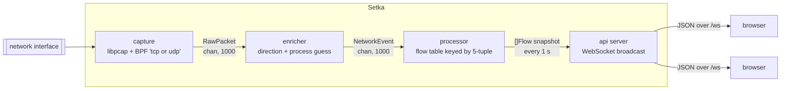

<div align="center">

<h1>Setka</h1>

<p><strong>Watch live network flows in your browser.</strong></p>

<p>
  
  
  
  <a href="LICENSE"></a>
</p>

<p>
  <a href="#why">Why</a> ·
  <a href="#how-it-works">How it works</a> ·
  <a href="#getting-started">Getting started</a> ·
  <a href="#usage">Usage</a> ·
  <a href="#data-model">Data model</a> ·
  <a href="#limitations">Limitations</a>
</p>

</div>

Setka ("network" in Russian) captures the TCP and UDP traffic on a network interface, groups
the packets into flows, and streams those flows to a web page once a second. You get a
live table of who your machine is talking to, on which port, and how much data is moving each
way.

## Why

Tools like Wireshark show every packet, which is far too much detail to answer a simple
question: *what is my machine connected to right now?* `netstat` and `lsof` answer that
question, but only as a static snapshot with no traffic volume. Setka sits in between: it
captures packets the way Wireshark does, but shows only the aggregated flows, live in the
browser.

It is also a compact example of a concurrent Go pipeline: four stages, each in its own
goroutine, connected by buffered channels.

## How it works



| Stage | Package | What it does |
| --- | --- | --- |
| Capture | `internal/capture` | Opens the interface in promiscuous mode with libpcap, keeps only TCP and UDP, and decodes IP addresses, ports, protocol and size. |
| Enrich | `internal/enricher` | Marks each packet `inbound` or `outbound` by comparing the source IP with the machine's own address, and guesses the process from the port. |
| Process | `internal/processor` | Adds each packet to a flow, keyed by a hash of source, destination, ports and protocol. Every second it sends a snapshot of all flows, then drops flows idle for more than 60 seconds. |
| Serve | `internal/api` | Serves the page in `web/public` and pushes every snapshot as JSON to all connected WebSocket clients. |

Snapshots are sent with a non-blocking channel write. If the server falls behind, a snapshot is
skipped rather than stalling capture, so a slow browser never causes dropped packets.

## Getting started

### Requirements

- Go 1.21 or later
- libpcap: `brew install libpcap` (macOS) or `sudo apt-get install libpcap-dev` (Debian/Ubuntu)
- Root privileges, because opening an interface for capture needs them

### Run

```bash
git clone https://github.com/NoamFav/Setka.git
cd Setka
go mod download
sudo go run ./cmd/netviz
```

Run it from the repository root, because the web page is served from `./web/public`. Then
open <http://localhost:8080> and generate some traffic:

```bash
curl -s https://example.com > /dev/null
```

The connection appears in the table within a second.

## Usage

```bash
sudo go run ./cmd/netviz -i en0                     # capture on a specific interface
sudo go run ./cmd/netviz -addr 0.0.0.0:9000         # serve on another address
make build && sudo ./bin/netviz -i eth0             # build a binary first
```

| Flag | Default | Description |
| --- | --- | --- |
| `-i` | `any` | Interface to capture on (`en0`, `eth0`, `wlan0`…). Run `ifconfig` or `ip link` to list them. |
| `-addr` | `localhost:8080` | Address the web server listens on |

The page shows one row per flow:

| Column | Meaning |
| --- | --- |
| Process | Guessed from the port: `browser` (80, 443), `ssh` (22), `dev-server` (3000), otherwise `unknown` |
| Remote IP, Port | The other end of the connection |
| Protocol | `TCP` or `UDP` |
| Direction | `inbound` or `outbound` |
| Sent, Received | Bytes in each direction |
| Packets | Packets seen in the flow |

## Data model

Each WebSocket message is a JSON array of flows:

```json
[
  {
    "id": "3f9c1a7be04d2c11",
    "local_ip": "192.168.1.20",
    "remote_ip": "93.184.215.14",
    "remote_port": 443,
    "protocol": "TCP",
    "process_name": "browser",
    "direction": "outbound",
    "bytes_sent": 5120,
    "bytes_recv": 0,
    "packet_count": 12,
    "first_seen": "2026-11-15T21:30:00Z",
    "last_seen": "2026-11-15T21:30:02Z"
  }
]
```

You can consume the stream from any WebSocket client, for example:

```bash
websocat ws://localhost:8080/ws | jq '.[] | {remote_ip, remote_port, bytes_sent}'
```

## Limitations

- **Process names are guessed** from a small port table, not looked up from the OS.
- **Flows are one-directional.** The flow key includes the direction, so the two halves of a
  TCP connection appear as two rows.
- **Only IPv4 and IPv6 over TCP and UDP.** ICMP, ARP and other protocols are filtered out.
- **No history.** Flows disappear 60 seconds after their last packet, and nothing is stored.
- **Local only by default.** The page has no authentication, so think twice before binding
  `-addr` to a public interface.

## Roadmap

- Real process lookup (`lsof` / `/proc` / `libproc`)
- Merge both directions of a connection into one flow
- Reverse DNS and GeoIP for remote addresses
- A flow graph view (D3.js) alongside the table
- A REST endpoint for one-off snapshots

## Project structure

```
cmd/netviz/        entry point: flags and pipeline wiring
internal/capture/  libpcap capture
internal/enricher/ direction and process guess
internal/processor/flow aggregation and cleanup
internal/api/      HTTP and WebSocket server
pkg/models/        RawPacket, NetworkEvent and Flow
web/public/        the browser UI
```

## License

Licensed under the [Apache License 2.0](LICENSE). See [NOTICE](NOTICE) for copyright
and attribution notices.
